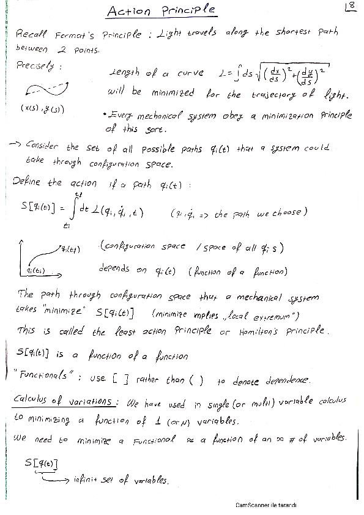
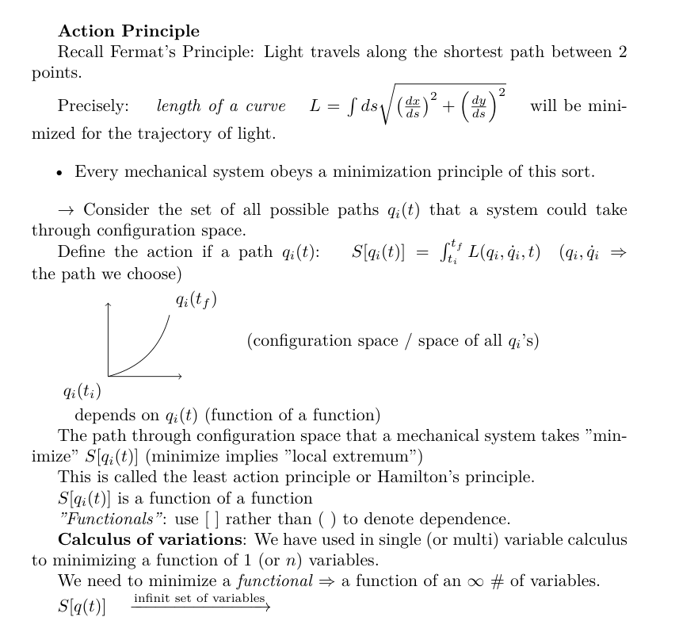

# NotesToLatex

Convert handwritten notes with equations into latex / pdfs, using locally hosted vision models

## Setup

Will work with any other OpenAI API compatible server (i.e VLLM)
```
uv sync
ollama pull qwen3-vl:8b-instruct
```

## Usage

Tested with ollama on windows.
```
uv run notes_to_latex.py --image_dir example --out_dir example --base_url http://localhost:11434/v1 --model qwen3-vl:8b-instruct
```

## Input / Output example

| Input | Output |
|---|---|
|  |  |

Not bad for a small model.
Will do even better with OpenAI API key etc.